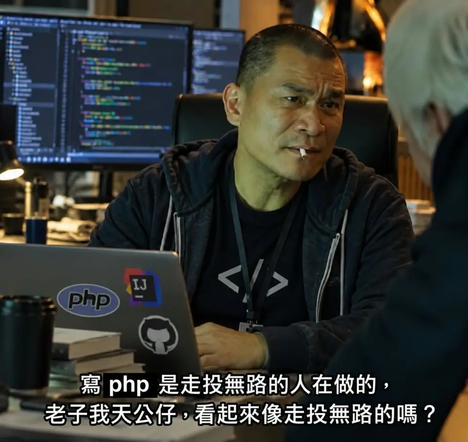

# 天公仔CMS

<p align="center">
  
</p>

**寫文章、填欄位、放圖片；其餘交給網站自動整理。**

Astro 在建置時產生靜態 HTML。內容採 WordPress 的 Post（文章）／Page（獨立頁面）邏輯，不需要資料庫或管理後台。

> 公版預設不開放搜尋引擎收錄。範例內容另有保護，整站開啟索引後也不會收錄範例。

## 我想查看網站

| 想看什麼 | 點這裡 |
| --- | --- |
| 有哪些網址、各自對應哪個檔案 | **[網站結構總覽](docs/SITE_STRUCTURE.md)** |
| **多語言（可選）** | [多語言設定、翻譯文章、語言切換與 SEO](docs/多語言設定.md) |
| 文章內容 | [文章資料夾](content/posts) |
| 關於、服務等獨立頁面 | [獨立頁面資料夾](content/pages) |
| 分類、標籤與主題中心 | [內容管理](docs/內容管理.md) |
| 網域、站名、GTM 與收錄設定 | [網站設定](site.config.json)・[中文欄位說明](docs/設定說明.md) |
| 圖片怎麼上傳 | [圖片操作](docs/圖片操作.md) |
| **S3 KEY、B2 機房與 Actions 設定測試** | **[圖床完整操作教學](docs/S3圖床設定.md)** |
| **CPT 自訂文章類型（Cars 等）** | **[CPT 建立與維護](docs/CPT自訂內容.md)** |
| Cloudflare Pages 怎麼接 | **[第一次部署教學](#cloudflare-pages-部署教學)**・[完整部署說明](docs/部署說明.md) |
| Agent 該遵守什麼規則 | [AGENTS.md](AGENTS.md) |
| 功能與驗收範圍 | [功能與驗收](docs/功能與驗收.md) |

## 在 GitHub 執行網站驗收

開啟倉庫的 [Actions（動作）](../../actions)，在左側選擇「網站自動驗收」，按 **Run workflow（執行工作流程）** 並選擇 `main`，就能手動跑完整檢查。修改程式碼或提出 PR 時也會自動執行。

> 已提供「網站初始化精靈」及「S3 一站式圖床設定」兩個手動工作流程；建議先將此範本複製成私人倉庫再設定正式站。

## 不寫程式初始化網站

複製本公開範本為私人倉庫後，開啟 **Actions → 網站初始化精靈 → Run workflow**，先填網站名稱、網域、簡介與作者。接著使用唯一的 **Actions → 圖床設定｜S3 一站式驗證與套用**，選供應商＋機房與 Bucket，自訂 CDN 優先；沒有自訂時手動啟用 B2 公開下載網址。按 Run 便會先真實上傳／CDN 單次 HEAD 連結檢查，全部通過才提交設定。詳見 [中文初始化說明](docs/初始化精靈.md)；原 B2 Native 流程未主動切換前仍保留。

## Cloudflare Pages 部署教學

**第一次使用也可以照這段操作，不需要會寫程式、自己架伺服器，或在 Cloudflare 填寫 S3 金鑰。** 本公版是 Astro 靜態網站，使用 **Cloudflare Pages**（不要選成 Workers），連接 GitHub 後就能自動部署。

### 第一步：建立自己的 GitHub 網站倉庫

1. 在本公版的 GitHub 頁面點 **Use this template → Create a new repository**，建立自己的網站倉庫；正式網站建議選 **Private**。**不要直接把公版倉庫當成你的正式網站**。
2. 進入新倉庫的 **Actions → 網站初始化精靈 → Run workflow**，填入自己的網站名稱、網域、簡介等資料並執行。這會更新 `site.config.json`；詳細欄位見 [初始化說明](docs/初始化精靈.md)。
3. 確認 GitHub 倉庫已有 `main` 分支。Cloudflare 要連接的是**剛建立的新倉庫**，不是 `CMS-Template-Public` 公版。

### 第二步：在 Cloudflare 建立 Pages 專案

1. 登入 [Cloudflare 控制台](https://dash.cloudflare.com/)。
2. 進入 **Workers & Pages → Create application（建立應用程式）→ Pages**。不同版面的按鈕名稱可能略有差異，請選 **Import an existing Git repository／Connect to Git（連接 Git 儲存庫）**。
3. 選擇 **GitHub**，按照畫面授權 Cloudflare 存取你的 GitHub 倉庫；看不到私人倉庫時，檢查 GitHub 整合是否授權該倉庫。
4. 選取第一步建立的**自己的網站倉庫**，再按 **Begin setup（開始設定）**。

### 第三步：填寫組建設定（這兩欄一定要填對）

| Cloudflare Pages 設定欄位 | 請填入 |
| --- | --- |
| Production branch（正式部署分支） | `main` |
| Framework preset（框架預設） | `Astro`；也可選 `None`，但下方兩欄仍需手動填寫 |
| **組建命令（Build command）** | **`npm run build`** |
| **組建輸出目錄（Build output directory）** | **`dist`** |
| Root directory（根目錄） | **留空**，使用 GitHub 倉庫根目錄 |
| Node.js 版本 | **24**；倉庫已有 `.nvmrc`，內容為 `24` |

**最重要的兩個值，直接照填：**

`組建命令：npm run build`

`組建輸出目錄：dist`

> `dist` 是網站建置後產生的檔案目錄，**不是** `src`、`public` 或 GitHub 倉庫網址。即使框架選了 Astro，也要再確認這兩欄沒有自動帶錯。Cloudflare Pages 的建置環境可透過 `.nvmrc` 選用 Node.js 24；若版本未正確套用，可在 Pages 的環境變數設定 `NODE_VERSION=24`。

### 第四步：部署並確認網站真的可以打開

1. 按 **Save and Deploy（儲存並部署）**，查看首次部署的建置紀錄，確認完成且顯示 **Success**。
2. Cloudflare 會提供類似 `https://你的專案名稱.pages.dev` 的測試網址。**實際打開它**，確認首頁、其他頁面能載入，而不是只看到部署的綠色勾勾。
3. 以後將修改提交到 GitHub 的 `main` 分支，Cloudflare Pages 就會自動重建並部署；PR／其他分支也可產生預覽網址。

**部署顯示成功，但網頁卻是 404？** 先回到 Pages 的 **Settings → Builds & deployments（組建與部署設定）** 檢查是否為 `npm run build`、`dist`、`main`，並確認連的是自己的倉庫、最新 Production 部署確實包含新 Commit。**修改組建設定後要重新觸發正式部署**，舊部署不會自行變成新設定。若 `pages.dev` 正常但自訂網域不正常，再檢查下一步的網域綁定與 DNS。

### 第五步：綁定自己的正式網域（可先跳過）

1. 進入 **Workers & Pages → 你的 Pages 專案 → Custom domains（自訂網域）→ Set up a domain（設定網域）**，輸入網站正式網域。
2. 如果網域 DNS 已由同一個 Cloudflare 帳號管理，按照指示完成網域綁定；Cloudflare 通常會協助新增所需紀錄。
3. 如果子網域使用其他 DNS 服務商，先在 Pages 介面新增該自訂網域，再依指示建立 **CNAME** 指向 `你的專案名稱.pages.dev`；不要只新增 DNS 紀錄卻不在 Pages 綁定網域。
4. 根網域（例如 `example.com`）需要依照 Cloudflare 的名稱伺服器設定流程處理；已經指向其他主機、Tunnel 的同名 DNS／路由，必須先確認不會衝突。
5. 最後確認 `site.config.json` 的 `domain` 是你的正式網域，且正式網域 **HTTPS 可正常開啟網站內容**。

**備註：** 網站部署到 Pages 不需要設定 Backblaze B2／S3 金鑰。圖床是另一個步驟，依照 [S3 圖床設定](docs/S3圖床設定.md) 再處理即可。網站一開始不能收錄是因為公版預設 `indexable: false`；正式內容與網域都準備好，再依 [設定說明](docs/設定說明.md) 開啟搜尋引擎收錄。

進階設定與驗收請看 [GitHub 與 Cloudflare Pages 部署說明](docs/部署說明.md)，或參考 [Cloudflare 官方 Astro 部署教學](https://developers.cloudflare.com/pages/framework-guides/deploy-an-astro-site/)。

## 建立新網站

將倉庫設為 GitHub Template（範本倉庫），再用「Use this template／使用此範本」建立新站。每站獨立修改與部署，公版更新不會自動改到舊站。

本機需要 Node.js 24：

```bash
npm ci
npm run site:init -- --domain your-domain.com --title "我的網站"
npm run dev
```

`domain` 是正式網域，`title` 是站名。圖片網址預設跟著變成 `cdn.your-domain.com`；DNS（網域設定）及 CDN（內容傳遞網路）仍需先接妥。

## 新增文章

```bash
npm run content:new -- --type post --uid 我的第一篇 --title "我的第一篇文章" --slug 我的第一篇 --category 網站教學
```

`uid` 是永久內容識別碼，`slug` 是固定網址名稱，`category` 是分類 ID。新文章預設草稿，完成後將 `draft` 改為 `false`，再執行：

```bash
npm run urls:update
npm run verify
npm run media:verify
```

將內容、圖片紀錄、網址紀錄與結構報表一起提交，再開 PR（合併請求）。

## 網址規則

| 類型 | 網址 |
| --- | --- |
| 首頁 | `/` |
| Post 文章 | `/{分類網址}/{文章網址}/` |
| Page 獨立頁面 | `/{頁面網址}/` |
| 分類彙整 | `/{分類網址}/`（各分類有獨立彙整頁） |
| 標籤彙整 | `/tag/{標籤網址}/` |
| 全部文章列表 | `/blog/` |

`/blog/` 僅為全部文章總覽，文章正式網址使用 `/{分類網址}/{文章網址}/`。`Category` 是真分類，各分類保有 `/{分類網址}/` 彙整頁；變更分類會改變文章網址，必須保留原分類 URL 的 301。前一版 `/blog/{文章網址}/` 也直接 301 到分類文章。`site.config.json` 的 `blogLegacyPaths` 保護舊入口；`relatedArticles.maxItems` 控制每篇文章延伸閱讀總名額（含正文手動內連），預設 4、最多 12。可以使用中文網址。

## 自動處理的功能

- 分類、標籤、列表與分頁，並控制彙整頁收錄。
- 主題中心與子文章雙向連結，每次建置重算新舊文章推薦。
- SEO 標題、簡介、Canonical（標準網址）、OG（分享預覽）、結構化資料、麵包屑、Sitemap（網站地圖）。
- 草稿、範例、預覽環境索引保護；網址衝突、301 轉址及既有網址保護。
- 內部失效連結、段落連結、圖片替代文字、孤兒頁與 HTML 大小驗收。
- B2／R2／AWS S3 圖片縮圖、雜湊檔名、S3 上傳、CDN 校驗與回填。
- 中文網站結構表、Agent 內容索引及中文驗收報表。

## 專案位置

| 位置 | 用途 |
| --- | --- |
| `content/posts/`、`content/pages/` | 文章與獨立頁面 |
| `content/categories/`、`tags/`、`topics/` | 分類、標籤與主題 |
| `content/media/manifest.json` | 上傳圖片及校驗紀錄 |
| `content/url-lock.json` | 既有網址與轉址紀錄 |
| `src/pages/` | 首頁與共用頁面產生器 |
| `src/components/` | 頁首、頁尾、SEO 與列表 |
| `src/layouts/`、`src/styles/` | 版型與外觀 |
| `scripts/` | 操作指令、圖片及驗收工具 |
| `docs/` | 中文說明與網站結構 |
| `.github/workflows/` | PR 與主分支自動檢查 |

頁面預設不載入自家前端 JavaScript，採精簡 CSS 與系統字型。GTM 只在填入 ID 後載入，事件由你自行管理。不預裝搜尋、會員、購物車或後台。

外觀請改 `.astro` 和 CSS。`dist/` 是建置結果，下次會重產，不是原始碼。

## 全站 POST 頁尾（簡化與開關）

[POST 頁尾設定：標籤、作者、推薦與自訂區塊](docs/POST頁尾設定.md)。所有文章共用 `site.config.json` 設定；閱讀提醒、主題中心跳轉及服務諮詢卡片不再自動插入文章。新增自訂區塊可先設 `enabled:false` 保留內容，未來再啟用。複雜銷售與互動請自行建立 Page。

## 301 轉址容量防呆

[Cloudflare Pages 301 轉址容量與清理設定](docs/轉址容量管理.md)：預設 1500／1800／1950 條分級提醒，1950 後新增每條提醒；超過 1950 自動淘汰最舊建立的規則。日期清理預設不啟用、天數 90 可設定。轉址台帳永久保留建立日期與退役紀錄。

## 5,000 頁媒體成本優化

內文圖片保持一行 Markdown URL，封面另存 YAML；`content/media/manifest.json` 是雜湊與尺寸收據，實體圖片由 B2／S3 保存。正常 CI 不再連線下載、重驗任何媒體；只有手動執行 `media:verify` 才以 HEAD 查死圖。`npm run media:orphans` 產出候選報表但絕不自動刪除遠端檔案。詳見 [圖片操作](docs/圖片操作.md)。

## 大型網站 Sitemap（SEO）

自動生成 `/sitemap.xml` 總索引，將 POST、PAGE、分類、TAG 分開成靜態子 Sitemap（與總索引放在網站根目錄，避免搜尋引擎的路徑範圍限制）；每份預設最多 **200 個 URL**，可在 `site.config.json` 的 `sitemap.maxUrls` 自訂。GSC 只需提交 `/sitemap.xml`；完整設定與 noindex 行為見 [設定說明](docs/設定說明.md)。

## S3 圖床設定（Actions 下拉選單）

只保留一個 **Actions → 圖床設定｜S3 一站式驗證與套用**。在單一下拉選供應商＋機房（含 `b2-us-west-002`），或選 `custom` 手填特殊 S3 Endpoint；再填 Bucket（可留空嘗試自動辨識）與 CDN 完整 HTTPS URL。S3 金鑰只放 GitHub Secrets。**Run 會實測 S3 上傳、CDN 單次 HEAD 連結檢查（不下載圖片），通過才更新設定**；不會自動公開私有 Bucket。詳見 [完整設定與驗收](docs/S3圖床設定.md)。

## 附件與 CPT 檔案（PDF／ZIP）

現在使用現有的 `npm run media:add` 就能把 PDF／ZIP／Word／Excel 等附件原樣上傳到已設定的 B2／S3，並自動寫入 CPT `file` 欄位或 Blog／Page 下載連結；不需要替附件手動複製網址。CPT `gallery` 可以用 `--field` 一次追加一張圖片。詳見 [圖片與附件操作](docs/圖片操作.md) 和 [CPT 設定](docs/CPT自訂內容.md)。附件上限 100 MiB；**此公開圖床不適合上傳機敏資料**。

**GitHub Secrets 已填好的人：** 直接在 **Actions → 媒體上傳｜圖片與 PDF／ZIP 附件** 上傳，接受 HTTPS 檔案 URL 或 Repo 來源路徑，預設 `dry_run` 預覽；成功後會自動填回 CPT 欄位或文章連結、更新媒體索引並提交 main，不需要本機重填 KEY。[查看操作](docs/圖片操作.md#不用本機-key直接從-github-actions-上傳附件)。
